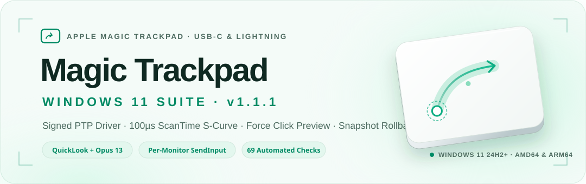
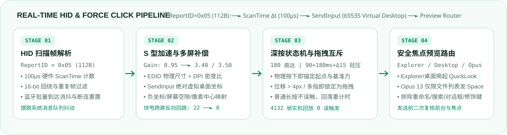
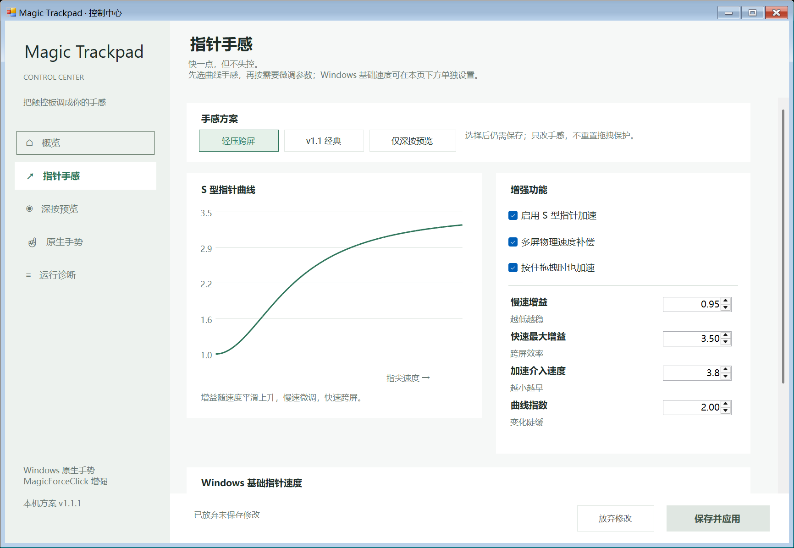

<p align="center">
  <picture>
    <source media="(prefers-color-scheme: dark)" srcset="assets/hero-dark.svg">
    <source media="(prefers-color-scheme: light)" srcset="assets/hero-light.svg">
    
  </picture>
</p>

<div align="center">
<details><summary><b>Read this in other languages / 切换语言</b></summary>

<a href="../README.md">简体中文</a> | <a href="README.en.md">English</a>

</details>
</div>

<p align="center">
  <a href="https://github.com/CNDDVP/apple-magic-trackpad-windows/releases"></a>
  <a href="https://github.com/CNDDVP/apple-magic-trackpad-windows/actions/workflows/build.yml"></a>
  <a href="https://github.com/CNDDVP/apple-magic-trackpad-windows/actions/workflows/release.yml"></a>
  <a href="../LICENSE"></a>
  
  
  <a href="../TEST_REPORT_v1.1.1.md"></a>
</p>

<p align="center">
  <b>Native Precision Touchpad gestures, hardware ScanTime S-curve acceleration, and drag-safe Force Click preview for Apple Magic Trackpad on Windows 11.</b><br/>
  Bundled signed driver remains v2.2 / INF <code>2026.3982.1.1000</code>; <b>1.2.0 is the suite version; the validated v1.1.1 backend is retained</b>.
</p>

Run a single PowerShell installer or hot-updater to equip your **Apple USB-C / Lightning Magic Trackpad** on Windows 11 with catalog-signed Precision Touchpad drivers, dual USB/Bluetooth registry profiles, **100µs hardware `ScanTime` S-curve pointer acceleration**, **Per-Monitor Virtual Desktop compensation**, and **Force Click file preview** across **File Explorer / Desktop (QuickLook)** and **Directory Opus 13**.

- **Hardware `ScanTime` velocity & multi-monitor `SendInput` compensation.** Computes finger velocity directly from the 112-byte `ReportID=0x05` HID packet's hardware `ScanTime` (100µs/tick with 16-bit wraparound) instead of noisy OS message-loop intervals. Multi-monitor DPI/EDID compensation submits absolute normalized virtual-desktop coordinates via `SendInput`, handling negative coordinates, inter-monitor gaps, and pixel-center mapping.
- **Physical button-down drag interlock & "Light Cross-Screen" preset.** Anchors start position and initial force at physical button-down; cursor/finger movement, multi-touch, or contact-ID swaps immediately lock the press as a drag and cancel preview until release. Includes an optional **Light Cross-Screen** preset (`90` threshold + `180ms` stability + `+15` pressure rise) so comfortable holds never misfire, while deliberate hard presses (`180`) still trigger instantly.
- **1-second live settings & byte-verified rollback snapshots.** Toggle Force Click preview, S-curve acceleration, and multi-monitor compensation independently in a clean WinForms GUI (`--settings`). Upgrades preserve your personal `MagicForceClick.json` and create a SHA256-verified `SnapshotDir` with an independent restore script.

> [!NOTE]
> **Honest scope on haptics & preview:** Explorer and Desktop preview uses [QuickLook](https://github.com/QL-Win/QuickLook). Directory Opus 13 support dispatches `Space` only when focus is inside a `dopus.exe` Lister file display (`Space` preview must already be enabled in Opus). **This suite does not add a separate second-stage physical haptic click.**

---

## Get started (30 seconds)

### Option A: Upgrade tooling on an already-configured PC

Download `MagicForceClick-v1.2.0-update.zip` from [Releases](https://github.com/CNDDVP/apple-magic-trackpad-windows/releases), extract it, and run in the signed-in user's PowerShell:

```powershell
.\Update_MagicForceClick.ps1
# Or explicitly target a custom runtime folder:
.\Update_MagicForceClick.ps1 -RuntimeDir 'C:\ActualPath\MagicTrackpad'
```

The updater detects your existing runtime path from the current user's startup entry, validates configuration, creates a rollback snapshot, stops the old process, and swaps binaries while keeping your existing `MagicForceClick.json`.

### Option B: Full installation on a new Windows 11 PC

Requires **Windows 11 24H2 (Build 26100+)** and **64-bit PowerShell** running elevated as the **currently signed-in interactive user** (do not elevate into a different admin account):

```powershell
git clone https://github.com/CNDDVP/apple-magic-trackpad-windows.git
cd apple-magic-trackpad-windows

# Standard install (v1.1 baseline curve + 180 Force Click threshold)
.\Install_All_MagicTrackpad.ps1 -CursorSpeed 14 -ForceClickThreshold 180

# Or install directly with the calibrated Light Cross-Screen preset
.\Install_All_MagicTrackpad.ps1 -CursorSpeed 14 -LightCrossScreen
```

---

## See it in action

<p align="center">
  <picture>
    <source media="(prefers-color-scheme: dark)" srcset="assets/demo-pipeline-dark.svg">
    <source media="(prefers-color-scheme: light)" srcset="assets/demo-pipeline-light.svg">
    
  </picture>
</p>
<p align="center">
  <em>End-to-end processing from 112-byte HID Report 0x05 packets to virtual-desktop SendInput compensation and focus-safe preview dispatch.</em>
</p>

Open the live settings window anytime:

```powershell
.\Open_MagicTrackpad_Settings.cmd
# or:
.\MagicForceClick.exe --settings
```

---

## What it does

| Capability | What you get |
|---|---|
| **Directory Opus 13 Force Preview** | Detects `dopus.exe` Lister file lists (`dopus.filedisplay` / `dopus.iconfiledisplay`) and invokes existing `Space` preview. Never sends `Space` in rename boxes, address/search bars, embedded viewers, dialogs, or while modifier keys are held. |
| **Light Cross-Screen Preset** | Threshold `90`, `180ms` stability dwell, and `+15` pressure rise above button-down (ordinary holds never turn into long-press previews), plus immediate trigger at `180`. Calibrated curve: `0.95 / 3.5 / 3.8 / 2.0`. |
| **Hardware `ScanTime` Velocity** | Uses the 112-byte `ReportID=0x05` `ScanTime` counter (100µs/tick, 16-bit wrap) with dedicated handling for Bluetooth batch bursts, duplicate frames, counter resets, and contact-ID switches. |
| **Virtual Desktop `SendInput`** | Submits normalized absolute virtual-desktop coordinates via `SendInput`, handling negative coordinates, inter-monitor gaps, clamping, and pixel-center mapping without `SetCursorPos` snap-back. |
| **Low-Force Drag Interlock** | Anchors position and base force at physical button-down; cursor movement (`>4px`), finger travel (`>220`), multi-finger, or contact swaps lock the press as a drag until release. |
| **Verified Snapshot Rollback** | Every update outputs a `SnapshotDir` under `rollback-snapshots\` with file SHA256 hashes, startup state, and a standalone `Restore_MagicForceClick.ps1` script. |

---

## Validation & Benchmarks

Validated on **Windows 11 x64 + Bluetooth Apple USB-C Magic Trackpad (`A3120` / `PID 0324`) + signed driver `2026.3982.1.1000` + Directory Opus `13.25 x64`** (full details in **[TEST_REPORT_v1.1.1.md](../TEST_REPORT_v1.1.1.md)**):

| Suite / Replay | Result | Scope |
|---|---|---|
| **Offline Behavior Tests** | **59 passed** | Scan timing wrap, drag interlock, calibrated S-curve, dwell/rise/immediate paths, Opus focus routing, virtual desktop pixel mapping (`x=-1920..6399, y=0..2162`) |
| **Integration & ABI Tests** | **5 passed** | Live reload, invalid config protection/recovery, 4 switches / 9 numeric controls, native Windows `INPUT` ABI layout |
| **Update & Rollback Tests** | **5 groups passed** | Upgrade, byte-exact restore (`v1.1.1 -> v1.1.0` across 8 runtime files), corrupt snapshot rejection, failed-start auto-recovery |
| **Original Pressure Replay** | **2,810 frames passed** | 20 physical presses / 2,587 valid scan intervals: 4 drags rejected, 7 deep-press intents triggered, 0 ordinary-click false positives |
| **Comfort Pressure Replay** | **1,322 frames passed** | Ordinary clicks and 2 comfortable long holds rejected; deliberate deep press triggers 1 preview intent |
| **Cross-Monitor Flick Capture** | **`22 → 0` reversals** | Before: 2,080 frames with 22 large jumps opposite movement; After: 2,028 frames with **0** opposite jumps and **0** failed `SendInput` submissions |

---

## Rollback & Build

To roll back an upgrade using your local snapshot:

```powershell
powershell.exe -NoProfile -ExecutionPolicy Bypass -File 'ActualSnapshotDir\Restore_MagicForceClick.ps1' -SnapshotDir 'ActualSnapshotDir'
```

To compile from source and run the test suites locally:

```powershell
.\Build.ps1
.\tests\Test-UpdateRollback.ps1
```

---

## Credits & License

- **Signed Precision Touchpad Driver**: [mac-precision-touchpad](https://github.com/imbushuo/mac-precision-touchpad) (Bingxing Wang, Vito Plantamura).
- **Quick Preview Integration**: [QuickLook](https://github.com/QL-Win/QuickLook) and [Directory Opus 13](https://www.gpsoft.com.au/).
- **License**: Tooling source code and scripts are licensed under the **[MIT License](../LICENSE)**; bundled third-party binaries retain their respective licenses.

## Native Control Center in v1.2.0

The full installer and update package now include the five-page Control Center, its DPI configuration, a desktop shortcut and Open_MagicTrackpad_ControlCenter.cmd. It manages pointer curves, pressure preview, native gestures and live diagnostics, with JSON backups and external-edit protection. The validated v1.1.1 backend is retained; 1.2.0 is the suite version. See [Control Center guide](../MAGIC_CONTROL_CENTER.md), [release notes](../RELEASE_NOTES_v1.2.0.md) and [verification scope](../TEST_REPORT_v1.2.0.md).



The main branch also fixes preset selection, draft tracking and save feedback. Pointer presets preserve pressure settings and feature switches; reverted native edits become clean, and backend confirmation checks the matching process, timestamps, input registration and effective options. See the [settings-state fix notes](control-center-settings.md). Existing v1.2.0 release assets remain unchanged.

Held-button acceleration (`AccelerateWhilePressed`) is now **off by default** in both the configuration template and program fallback. This reduces amplification of small movements while physically clicking; normal pointer acceleration, cross-screen compensation, press-and-drag and pressure-preview settings are retained. Existing configurations, including an explicit `true`, are preserved during upgrades. To try this adjustment on an existing installation, clear **Accelerate while dragging** in Control Center and save. See the [click-stability validation notes](click-stability.md).
